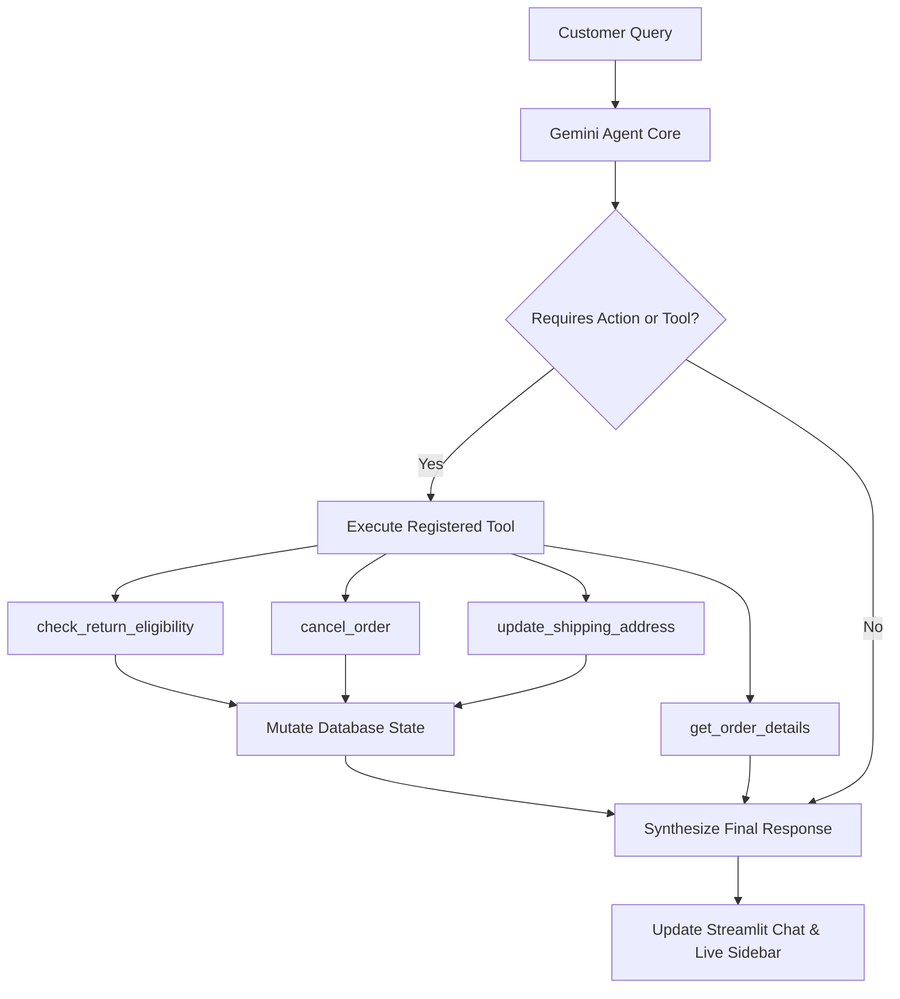

# 📦 E-Commerce Autonomous Support & Order Operations Agent

An autonomous AI agent built from scratch using Python, Google Gemini (Tool Calling), and Streamlit. The agent handles customer support inquiries, enforces business policies deterministically, updates order states in real time, and escalates edge cases to human representatives.

---

## 🎯 Problem Statement
E-commerce support teams spend substantial time on repetitive order queries—checking tracking statuses, validating return windows, processing cancellations, and modifying addresses. Traditional chatbots rely on static rule trees or hallucinate answers, while raw LLMs lack the ability to take actions.

This project bridges that gap by combining:
1. **LLM Reasoning (Gemini):** Understands natural language user intent and decides which tools to invoke.
2. **Deterministic Code/Tools:** Executes strict business policies (e.g., 7-day return window, cancellation restrictions for dispatched items).
3. **Live State Mutation:** Updates database records dynamically with real-time UI reflection.

---

## 🚀 Key Features

* **Order Status & Tracking:** Queries mock database records and retrieves item, shipment, and delivery details.
* **Policy-Enforced Returns:** Evaluates delivery date against the 7-day return window; initiates return workflows only for eligible orders.
* **Order Cancellation:** Allows cancellation for orders in `PROCESSING` state; blocks cancellation once items are marked `SHIPPED`.
* **Shipping Address Updates:** Updates delivery destination prior to dispatch; restricts modifications on in-transit or delivered orders.
* **Human-in-the-Loop Escalation:** Creates support tickets and escalates when automated policies cannot resolve the customer's request.
* **Interactive Web Dashboard:** Real-time chat interface paired with a live-updating database sidebar built in Streamlit.

---

## 🏗️ Architecture & Agent Workflow



---

## 📁 Project Structure

```text
order_agent/
│
├── database.py       # In-memory mock database of customer orders
├── tools.py          # Deterministic Python functions exposed as tools
├── agent.py          # Gemini API client, system prompt, and tool configuration
├── app.py            # Streamlit web application & live database viewer
├── main.py           # CLI interface for terminal testing
├── requirements.txt  # Project dependencies
├── .gitignore        # Ignores .env and virtual environment files
└── README.md         # Project documentation
```

---

## 🛠️ Tech Stack

* **Language:** Python 3.10+
* **LLM Engine:** Google Gemini API (`gemini-3.8-flash`) via `google-genai`
* **Agent Architecture:** ReAct / Autonomous Function Calling
* **Frontend:** Streamlit, Pandas
* **Environment Management:** `python-dotenv`

---

## ⚙️ Setup and Installation

### 1. Clone the Repository
```bash
git clone https://github.com/your-username/ecommerce-order-ai-agent.git
cd ecommerce-order-ai-agent
```

### 2. Create and Activate Virtual Environment
* **Windows:**
  ```bash
  python -m venv venv
  venv\Scripts\activate
  ```
* **Mac/Linux:**
  ```bash
  python3 -m venv venv
  source venv/bin/activate
  ```

### 3. Install Dependencies
```bash
pip install -r requirements.txt
```

### 4. Configure API Key
Create a `.env` file in the project root:
```env
GEMINI_API_KEY=your_gemini_api_key_here
```
*(Get a free API key from Google AI Studio: [https://aistudio.google.com/](https://aistudio.google.com/)).*

---

## 🖥️ Running the Application

### Option A: Web Interface (Streamlit)
```bash
streamlit run app.py
```
Open `http://localhost:8501` in your browser.

### Option B: Terminal CLI
```bash
python main.py
```

---

## 🧪 Test Scenarios

1. **Track Shipped Order:**
   * Query: `Where is my order ORD-102?`
   * *Behavior:* Calls `get_order_details` and reports that the item is currently shipped.

2. **Eligible Return:**
   * Query: `I want to return ORD-101 because the headphones are defective.`
   * *Behavior:* Verifies eligibility (delivered 2 days ago), schedules pickup, and updates `return_status` to `RETURN_REQUESTED`.

3. **Ineligible Return (Policy Enforcement):**
   * Query: `Can I return ORD-103?`
   * *Behavior:* Rejects request because delivery was 20 days ago (exceeding the 7-day window).

4. **Address Change:**
   * Query: `Change shipping address for ORD-104 to "Sector 17, Chandigarh"`
   * *Behavior:* Updates shipping address since order is still in `PROCESSING`.

5. **Human Escalation:**
   * Query: `I am very unhappy with order ORD-103, please escalate this to a supervisor.`
   * *Behavior:* Generates a unique support ticket ID via `escalate_to_human`.
